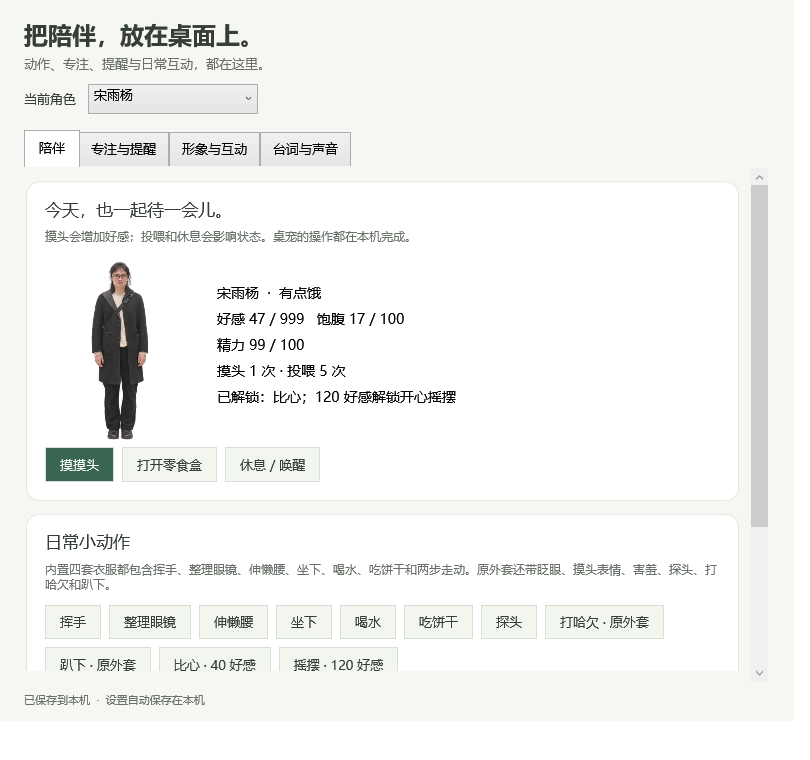

# 宋雨杨与 song雨杨 · 真人桌宠

基于 C# / WPF 的 Windows 真人写实桌宠。两个默认角色分别叫 **宋雨杨** 和 **song雨杨**，支持拖动、投喂、换装、双人互动、专注计时和喝水提醒。



## 下载与运行

从仓库 Releases 下载 `SongYuYang-DesktopPet-v2.0.1-win.zip`，解压后双击 `真人桌宠增强版.exe`。

- Windows 10 / 11，使用系统 .NET Framework 4.x 和 WPF。
- 运行时无需联网，无需安装 Python、Node 或额外运行时。
- 四套服装、44 张动作照片全部内嵌，可单独复制 EXE 使用。
- 默认显示两个角色；右键人物或双击托盘图标打开陪伴控制台。

## 功能

| 功能 | 行为 |
| --- | --- |
| 写实动作 | 走动、挥手、整理眼镜、伸懒腰、坐下、喝水、吃饼干；原外套另有眨眼、摸头表情、害羞、探头、打哈欠和趴下 |
| 鼠标互动 | 拖动搬家、滚轮缩放、点击头部摸头、点击身体显示台词、双击休息或唤醒 |
| 投喂与好感 | 从零食盒拖动或点击投喂；记录饱腹、精力、好感和互动次数；解锁比心与开心摇摆 |
| 鼠标跟随 | 沿水平方向追随光标，并轻轻转身 |
| 窗口停靠 | 坐在有足够上方空间的窗口上沿，跟随窗口移动；目标关闭或最小化后返回桌面 |
| 自动作息 | 夜间或电脑闲置时休息；支持手动唤醒和关闭自动作息 |
| 专注与提醒 | 可配置的番茄钟、暂停续计、休息阶段、喝水确认与稍后提醒 |
| 换装 | 原照片深色外套、奶油色家居卫衣、冬日围巾帽、酒红节日开衫 |
| 台词与声音 | 自定义气泡台词、导入音频、手动录音、互动与提醒播放 |
| 双人陪伴 | 两个角色单独命名、换装和设置，递饼干与一起坐下，可导入第二人物透明 PNG |

## 从源码构建

在 Windows PowerShell 或 PowerShell 中运行：

```powershell
./build.ps1
```

输出在 `dist/真人桌宠增强版.exe`。构建脚本使用 Windows 自带的 .NET Framework C# 编译器，不需要 NuGet 包或网络下载。

运行内置功能验证：

```powershell
& './dist/真人桌宠增强版.exe' --self-test "$PWD/test-results"
```

测试会创建独立的配置目录、临时窗口和截图，不读取或覆盖正常运行的个人设置。GitHub Actions 使用 Windows Runner 构建并执行相同验证。

## 设置与升级

个人设置、导入图片和录音保存在 `%LOCALAPPDATA%\PortraitPetPlus`。程序每 30 秒保存，正常退出时也会保存。

v2.0.1 首次读取旧版配置时，将两个角色改名为「宋雨杨」和「song雨杨」，保留好感度、服装、台词和其他设置。之后在控制台自定义的名称会保留。

转发 EXE 或发布压缩包不会自动携带本机设置和录音。程序不设置开机自启，退出后停止所有提醒；未完成的番茄钟不会在下次启动恢复。

## 素材与已知限制

- 人物动作和新增服装由内置 image_gen 工具参考用户提供的照片生成，提示词保存在 [ASSET_PROMPTS.txt](ASSET_PROMPTS.txt)。原始商场照片不放入仓库。
- 写实照片以动作帧切换和轻微动画呈现，并非连续真人视频；部分表情动作只适用于原外套形象。
- 第二角色默认使用同一人物的家居服分身。导入另一张透明 PNG 后可以更换形象；普通背景照片需先抠图。
- 单张 PNG 没有独立动作照片；支持 2×2 或 3×3 动作表以提供更多姿势。
- 声音功能播放用户提供的音频，不克隆声音，也不把台词自动合成为语音。录音需要可用麦克风与系统权限；本次未进行麦克风实录或所有音频编码的设备测试。
- 窗口上方空间不足时，停靠会回退到任务栏附近。

详细操作见 [使用说明](docs/使用说明.txt)。

## 目录

```text
src/                   C# 源码、WPF 清单、动作 PNG 与构建脚本
docs/                  操作说明、控制台截图与验证结果
.github/workflows/     Windows 构建和验证
build.ps1              构建入口
LICENSE                MIT License
```

## 开源许可

MIT License，见 [LICENSE](LICENSE)。
